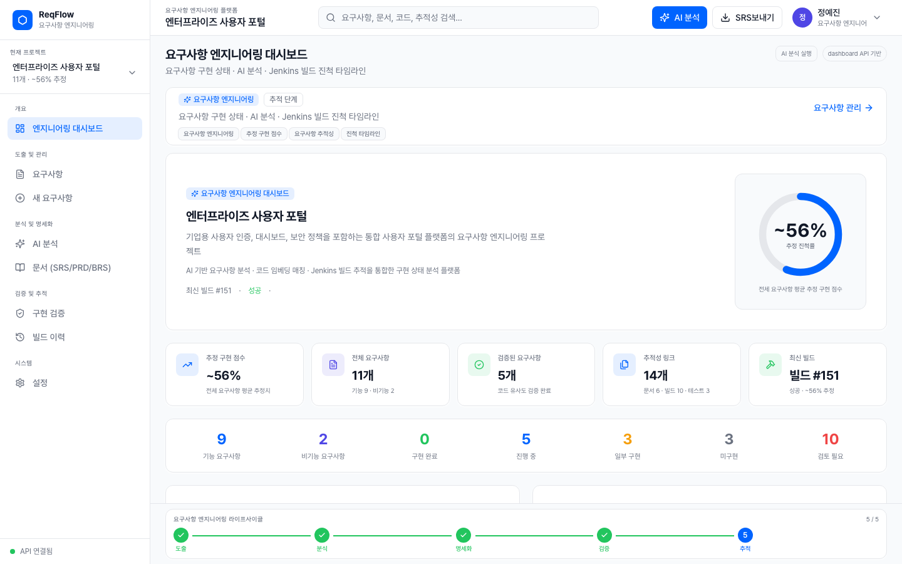
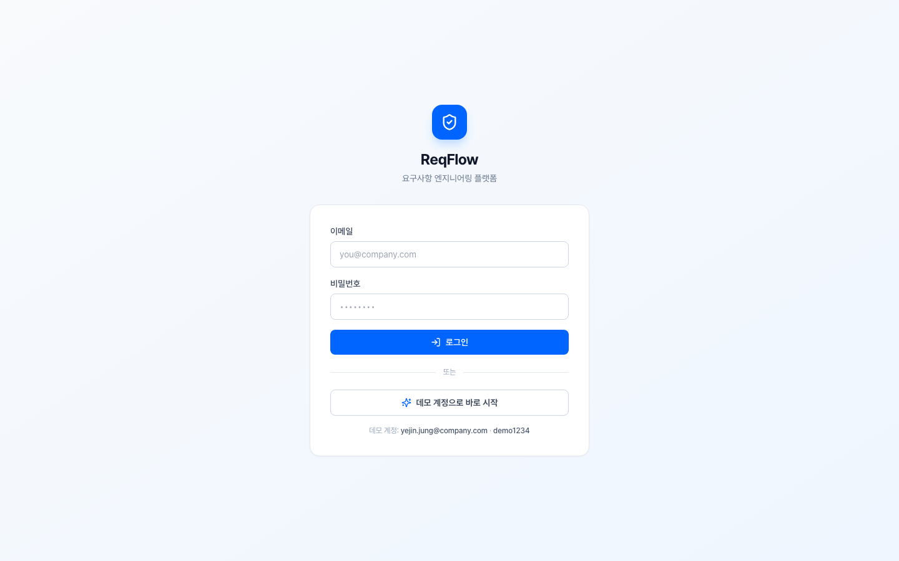
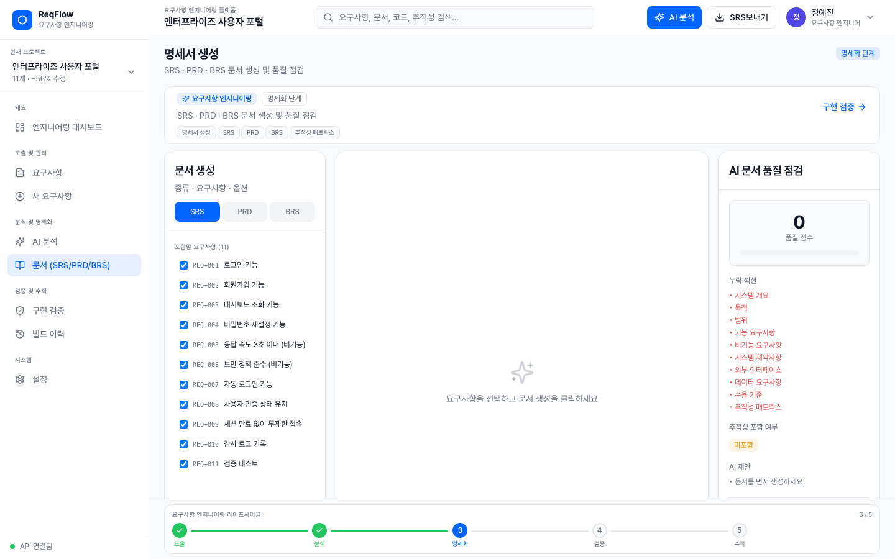
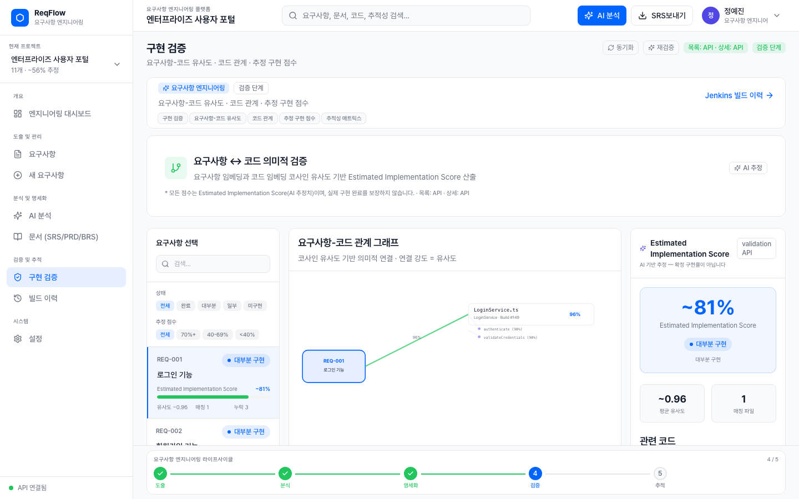
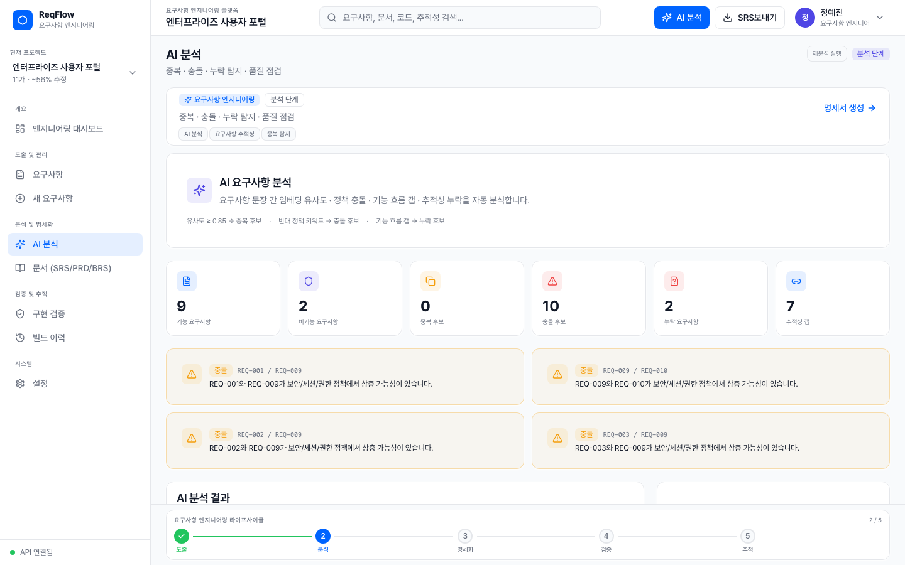
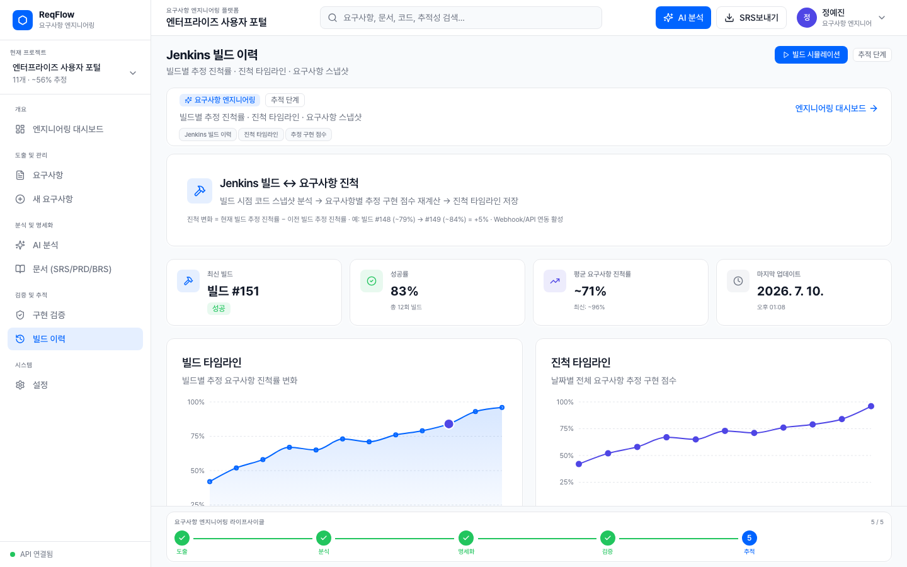
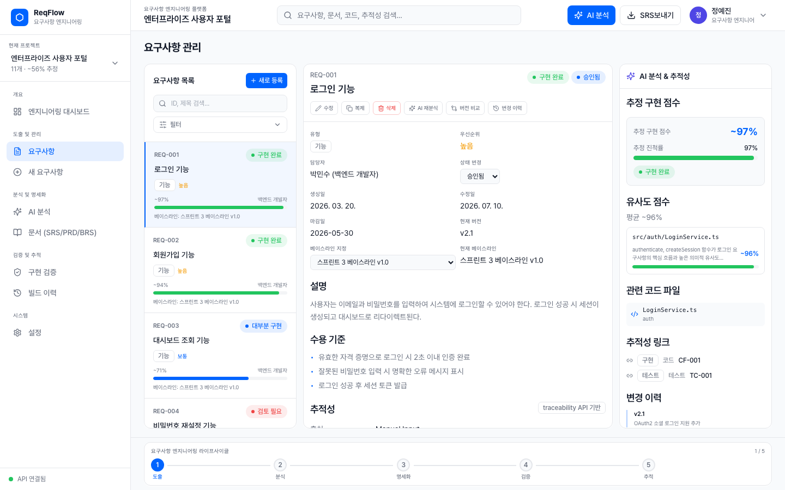

# ReqFlow — Requirements Engineering Platform

AI 기반 요구사항 관리 · 구현 검증 · 추적성 관리 PoC

React 프론트엔드와 **NestJS REST API**, **MySQL(Prisma) 영속화**를 결합한 **API-first Requirements Engineering Platform**입니다.  
대시보드 집계, AI 분석 재계산, 구현 검증, Traceability Matrix, Jenkins 빌드 시뮬레이션까지 하나의 시연 흐름으로 연결됩니다.

> 점수·분석·검증 결과는 모두 **Estimated Implementation Score / AI 추정치(규칙 기반 heuristic)**이며, 실제 구현 완료를 보장하지 않습니다.

<p>
  <a href="https://github.com/nnginii04/requirements-management-system/actions/workflows/ci.yml"></a>
  
  
  
  
  
</p>

---

## 미리보기



<table>
  <tr>
    <td width="50%"><br/><sub><b>Login</b> — JWT 인증 · 데모 원클릭 로그인</sub></td>
    <td width="50%"><br/><sub><b>Documents</b> — SRS/PRD/BRS 생성·품질 점검</sub></td>
  </tr>
</table>

<table>
  <tr>
    <td width="50%"><br/><sub><b>Validation</b> — 코드 유사도·추정 구현 점수</sub></td>
    <td width="50%"><br/><sub><b>AI Analysis</b> — 중복/충돌/누락 findings</sub></td>
  </tr>
  <tr>
    <td width="50%"><br/><sub><b>Build History</b> — Jenkins 빌드·진척 타임라인</sub></td>
    <td width="50%"><br/><sub><b>Requirements</b> — CRUD·버전·추적성</sub></td>
  </tr>
</table>

---

## 엔지니어링 하이라이트

포트폴리오 관점에서 이 프로젝트가 보여주는 것:

- **타입 안전 풀스택** — React + NestJS + Prisma를 하나의 TypeScript 모노레포로. 도메인 타입([`src/types/domain.ts`](src/types/domain.ts))을 프론트·백엔드가 공유.
- **정통 NestJS 아키텍처** — 모듈 · 컨트롤러 · DI 프로바이더 · 전역 예외 필터 · 로깅 인터셉터 · `ValidationPipe` DTO 검증.
- **JWT 인증** — 로그인 · 전역 `JwtAuthGuard`(+`@Public()`) · bcrypt 해시 자격증명 · 프론트 라우트 보호. 데모 계정으로 즉시 체험 가능.
- **관계형 DB 설계** — 14개 테이블 스키마, 버전 관리되는 Prisma 마이그레이션, 부팅 시 hydrate → 메모리 캐시 → write-back.
- **테스트 · CI** — 핵심 점수/상태 heuristic에 대한 vitest 유닛 테스트 + Playwright E2E, GitHub Actions에서 typecheck · build · test · e2e(MySQL 서비스 컨테이너) 자동 실행.
- **API 문서** — `@nestjs/swagger` 기반 라이브 문서 (`/api/docs`).
- **명시적 기술 결정** — 데코레이터 메타데이터를 위해 실행기를 SWC로 선정하는 등, 선택의 근거를 코드·문서에 남김.

---

## 주요 기능

| 영역 | 설명 |
|------|------|
| **Dashboard** | 프로젝트 KPI, 요구사항 커버리지, AI 인사이트, 검증 요약, 추적성 요약, 빌드 타임라인 |
| **Requirements** | CRUD, 베이스라인, 버전 이력, Traceability API 기반 상세 추적성 |
| **AI Analysis** | 중복/충돌/누락/추적성 갭 findings, 프로젝트 단위 재분석 |
| **Validation** | 요구사항-코드 유사도, Estimated Implementation Score, Traceability Matrix |
| **Build History** | Jenkins 빌드 이력, 시뮬레이션, 요구사항별 진척 스냅샷 |
| **Documents** | SRS / PRD / BRS 생성 및 품질 점검 |
| **Integrations** | GitHub / Jenkins webhook PoC, 빌드 기반 점수 갱신 |
| **Auth** | JWT 로그인, 라우트 보호, bcrypt 자격증명, 데모 계정 원클릭 로그인 |

---

## 빠른 시작

### 0. MySQL 준비 (최초 1회)

API는 MySQL에 데이터를 영속합니다. 로컬 MySQL을 띄우고 DB를 만든 뒤, 접속 정보를 `.env`에 설정합니다.

```bash
# Homebrew 기준 예시
brew services start mysql
mysql -u root -e "CREATE DATABASE IF NOT EXISTS reqflow CHARACTER SET utf8mb4 COLLATE utf8mb4_unicode_ci;"
```

`.env` (커밋 제외됨):

```bash
DATABASE_URL="mysql://root@localhost:3306/reqflow"
```

스키마를 DB에 반영하고 Prisma 클라이언트를 생성합니다.

```bash
npx prisma migrate deploy   # 마이그레이션 적용 (테이블 생성)
npx prisma generate         # Prisma Client 생성 (generated/prisma)
```

> 최초 API 실행 시 테이블이 비어 있으면 `src/mocks/data/*`에서 자동 시드됩니다.

### 1. 의존성 설치

```bash
cd 요구사항
npm install
```

### 2. 프론트 + API 함께 실행 (권장)

```bash
./dev-all.sh
# 또는
npm run dev:all
```

| 서비스 | URL |
|--------|-----|
| Frontend | http://localhost:5173 |
| API | http://localhost:3001 |
| Health check | http://localhost:3001/api/health |
| OpenAPI | http://localhost:3001/api/openapi.json |

> **로그인**: 첫 화면에서 **"데모 계정으로 바로 시작"** 버튼을 누르면 즉시 입장합니다. (계정: `yejin.jung@company.com` / `demo1234`)

### 3. 따로 실행

```bash
# 터미널 1 — 프론트 (Vite, /api → :3001 프록시)
npm run dev

# 터미널 2 — API
npm run dev:api
```

### 4. 프론트만 실행 (제한적)

```bash
./dev.sh
# 또는
npm run dev
```

API 없이 실행하면 화면은 뜨지만, 대부분의 데이터는 `src/mocks` fallback으로 동작합니다.  
**시연·개발 시에는 반드시 `npm run dev:all`을 사용하세요.**

### Node.js가 없을 때 (Mac)

`dev.sh`, `dev-all.sh`는 `~/.local/node` 경로의 Node를 우선 사용합니다.

```bash
export PATH="$HOME/.local/node/bin:$PATH"
./dev-all.sh
```

### 프로덕션 빌드

```bash
npm run build
npm run preview
```

---

## 시스템 아키텍처

```
사용자
  ↓
React Frontend (src/pages, src/components)
  ↓
Global State (AppContext, RequirementsContext)
  ↓
API Client + Utils (src/api, src/utils/*Api.ts)
  ↓  /api (Vite proxy → :3001)
NestJS Server (server/main.ts → AppModule)
  ↓
Controllers (server/modules/*)
  ↓
Core Services (server/core/*: Store / Recompute / Jenkins / Documents)
  ↓
Store (in-memory 캐시, MySQL에서 hydrate)
  ↓
MySQL (Prisma) — server/db/store.ts ↔ generated/prisma
  ↓
Frontend 화면 갱신 (refresh / reload)
```

### 데이터 흐름 원칙

1. 프론트는 **API 연결 시 서버 데이터를 우선** 사용합니다.
2. API 실패·오프라인 시 `src/mocks`로 **fallback** 합니다.
3. 재분석/재검증/빌드 시뮬레이션 결과는 **MySQL에 영속 저장**됩니다. (서버는 부팅 시 MySQL에서 상태를 메모리 캐시로 hydrate하고, 변경 시 캐시를 갱신한 뒤 MySQL로 write-back 합니다.)
4. 새로고침·서버 재시작 후에도 저장된 결과는 유지됩니다.

---

## Requirements Engineering Lifecycle

```
Elicitation → Analysis → Specification → Validation → Tracking
```

| 단계 | 경로 | 역할 |
|------|------|------|
| **Tracking / Overview** | `/dashboard` | KPI, AI 인사이트, 검증·추적성 요약, Build Timeline |
| **Elicitation** | `/requirements`, `/requirements/new` | 요구사항 CRUD, 베이스라인, 버전, 추적성 |
| **Analysis** | `/analysis` | 중복/충돌/누락 findings, 재분석 실행 |
| **Specification** | `/documents` | SRS / PRD / BRS 생성 |
| **Validation** | `/validation` | 코드 연관도, Estimated Score, Traceability Matrix |
| **Tracking** | `/build-history` | Jenkins 빌드 이력, 시뮬레이션, 진척 타임라인 |
| **Settings** | `/settings` | 프로젝트, 베이스라인, 연동 설정 |

---

## 시연 흐름 (권장 순서)

1. **Dashboard** 접속 → aggregate API로 전체 현황 확인
2. **AI 분석 실행** → analysis + validation recompute
3. **Analysis** → findings / summary 갱신 확인
4. **Requirements** → 상세 패널 Traceability API 확인
5. **Validation** → 재검증 후 점수·Missing Logic·AI 설명 확인
6. **Build History** → 빌드 시뮬레이션 실행
7. **Dashboard** → Build Timeline 반영 확인
8. **새로고침 · 서버 재시작** → MySQL 저장 결과 유지 확인

---

## 프로젝트 구조

### 루트

| 파일 | 역할 |
|------|------|
| `dev-all.sh` | 프론트 + API 동시 실행 (권장) |
| `dev.sh` | 프론트만 실행 |
| `package.json` | 스크립트 및 의존성 |
| `vite.config.ts` | Vite + `@/` alias + `/api` 프록시 |
| `playwright.config.ts` | E2E 테스트 설정 |

### `src/` — Frontend

| 경로 | 역할 |
|------|------|
| `pages/` | 화면 단위 진입점 (Dashboard, Requirements, Analysis, Validation, Build History 등) |
| `components/` | UI 컴포넌트 (dashboard, requirements, validation, build 등) |
| `contexts/` | `AppContext` (프로젝트/세션), `RequirementsContext` (요구사항 CRUD·API 연동) |
| `api/` | REST API 클라이언트 (`client.ts`, `types.ts`) |
| `utils/` | API fallback helper, 대시보드 집계, validation/traceability 로더 |
| `mocks/` | 오프라인 fallback 데이터 + 초기 seed 원본 |
| `hooks/` | 필터, workflow 보조 훅 |
| `layouts/` | AppLayout, Sidebar, TopHeader |
| `config/` | 라우트별 lifecycle 설정 |

#### 주요 Utils (API-first helper)

| 파일 | 역할 |
|------|------|
| `dashboard.ts` | Dashboard aggregate → UI stats 변환 |
| `analysisApi.ts` | Analysis findings/summary 로드 (API → mock fallback) |
| `validationApi.ts` | Validation 상세 로드 |
| `validationListApi.ts` | Validation 목록·대시보드 요약 로드 |
| `traceabilityApi.ts` | Traceability matrix / requirement trace 로드 |
| `documentsApi.ts` | 문서 카탈로그·생성 API 래퍼 |
| `settingsApi.ts` | 프로젝트·연동 설정 로드 |
| `buildHistory.ts` | 빌드 타임라인·필터 계산 |

### `server/` — Backend

| 경로 | 역할 |
|------|------|
| `main.ts` | NestFactory 부트, `/api` 글로벌 프리픽스, CORS, 서버 리슨 |
| `app.module.ts` | 루트 모듈 (CoreModule import + 컨트롤러 등록) |
| `modules/` | 도메인별 NestJS 컨트롤러 (requirements, validation, dashboard 등) |
| `core/` | `@Global` CoreModule — Store/Recompute/Jenkins/Documents `@Injectable` 서비스 |
| `core/store.service.ts` | Store 파사드 (`OnModuleInit`에서 hydrate + seed) |
| `core/http-error.ts` | `{ error }` 응답 형태 보존 헬퍼 |
| `services/recompute.ts` | analysis / validation 재계산, traceability sync |
| `services/jenkins.ts` | 빌드 처리, snapshot·점수 갱신, webhook 연동 |
| `services/documents.ts` | 문서 생성·품질 점검 |
| `lib/scoreEngine.ts` | implementation score 계산 |
| `lib/snippets.ts` | validation match용 코드 스니펫 보강 |
| `db/store.ts` | MySQL hydrate → 메모리 캐시, mutate/persist write-back |
| `db/prisma.ts` | Prisma Client 싱글턴 (mariadb driver adapter) |
| `db/seed.ts` | DB가 비어 있으면 mock 데이터 시드 |
| `prisma/schema.prisma` | MySQL 스키마 (14개 테이블) |

---

## 데이터베이스 (MySQL · Prisma)

스키마는 [`prisma/schema.prisma`](prisma/schema.prisma)에 정의된 14개 테이블입니다. 최상위 스칼라 필드는 컬럼으로, 중첩 배열·객체(traceabilityLinks, validation matches 등)는 JSON 컬럼으로 저장됩니다. 강제 외래키는 4개(`requirements→projects`, `versions→requirements`, `builds→projects`, `documents→projects`)이며, 나머지 관계는 애플리케이션 레벨 규약입니다.

| 테이블 / 컬렉션 | 용도 |
|--------|------|
| `projects` | 멀티 프로젝트, 활성 프로젝트 |
| `users` | 담당자, 현재 사용자 |
| `requirements` | 요구사항 본문, 상태, implementationScore |
| `versions` | 요구사항 변경 이력 |
| `baselines` | 베이스라인 스냅샷 |
| `analysisFindings` | AI 분석 findings (recompute 시 갱신) |
| `validationDetails` | 코드 매칭, missingLogic, aiExplanation |
| `traceabilityRecords` | 요구사항-문서-코드-빌드-테스트 연결 |
| `builds` | Jenkins 빌드 이력 |
| `snapshots` | 빌드별 요구사항 진척 스냅샷 |
| `documents` | 명세 문서 카탈로그 |
| `generatedDocuments` | 생성된 SRS/PRD/BRS |
| `webhookEvents` | GitHub/Jenkins webhook 이벤트 로그 |
| `activeProjectId` / `currentUserId` | 세션 상태 |

최초 API 서버 실행 시 테이블이 비어 있으면 `src/mocks/data/*`에서 시드되며, 이후 CRUD·recompute·build 결과는 MySQL에 저장됩니다. 데이터는 `npx prisma studio`로 GUI 확인이 가능합니다.

---

## REST API

프론트는 API 연결 시 아래 엔드포인트를 우선 사용하고, 실패 시 `src/mocks`로 fallback합니다.

### Health / Meta / Auth

| 메서드 | 경로 | 설명 |
|--------|------|------|
| GET | `/api/health` | 헬스체크 (public) |
| GET | `/api/openapi.json` | OpenAPI 3.0 스펙 (public) |
| GET | `/api/docs` | Swagger UI |
| POST | `/api/auth/login` | 로그인 → JWT 발급 (public) |
| GET | `/api/auth/me` | 현재 인증 사용자 |

> `/api/health`·`/api/openapi.json`·`/api/auth/login`을 제외한 모든 엔드포인트는 `Authorization: Bearer <token>`이 필요합니다.

### Projects / Users / Session

| 메서드 | 경로 | 설명 |
|--------|------|------|
| GET | `/api/projects` | 프로젝트 목록 |
| GET | `/api/projects/:projectId` | 프로젝트 상세 |
| GET | `/api/projects/active/current` | 현재 세션 (활성 프로젝트·사용자) |
| PATCH | `/api/projects/active` | 활성 프로젝트 전환 |
| GET | `/api/projects/:projectId/baselines` | 베이스라인 목록 |
| GET | `/api/projects/:projectId/integrations` | Jenkins/Git/AI 연동 상태 |
| GET | `/api/users` | 사용자 목록 |
| GET | `/api/users/me` | 현재 사용자 |
| PATCH | `/api/users/me` | 현재 사용자 전환 |

### Requirements

| 메서드 | 경로 | 설명 |
|--------|------|------|
| GET | `/api/requirements` | 요구사항 목록 |
| GET | `/api/requirements/:id` | 요구사항 상세 |
| POST | `/api/requirements` | 요구사항 생성 |
| PATCH | `/api/requirements/:id` | 요구사항 수정 |
| DELETE | `/api/requirements/:id` | 요구사항 삭제 |
| GET | `/api/requirements/:id/versions` | 버전 이력 |
| GET | `/api/requirements/:id/impact` | 변경 영향 분석 |
| GET | `/api/versions` | 전체 버전 이력 |
| GET | `/api/versions/requirements/:requirementId` | 요구사항별 버전 |

### Dashboard (Aggregate)

| 메서드 | 경로 | 설명 |
|--------|------|------|
| GET | `/api/dashboard/projects/:projectId` | 대시보드 집계 (KPI, coverage, AI insights, validation summary, traceability summary, build timeline) |

### Analysis

| 메서드 | 경로 | 설명 |
|--------|------|------|
| GET | `/api/analysis/projects/:projectId/findings` | 프로젝트 findings |
| GET | `/api/analysis/projects/:projectId/summary` | 분석 요약 |
| GET | `/api/analysis/findings/:id` | finding 상세 |
| POST | `/api/analysis/projects/:projectId/recompute` | AI 분석 재계산 (findings + traceability sync) |

### Validation

| 메서드 | 경로 | 설명 |
|--------|------|------|
| GET | `/api/validation?projectId=` | 검증 목록 요약 |
| GET | `/api/validation/:requirementId` | 검증 상세 + 스니펫 |
| POST | `/api/validation/:requirementId/recompute` | 단일 요구사항 재검증 |
| POST | `/api/validation/projects/:projectId/recompute` | 프로젝트 전체 재검증 |

### Traceability

| 메서드 | 경로 | 설명 |
|--------|------|------|
| GET | `/api/traceability/projects/:projectId/matrix` | 프로젝트 Traceability Matrix |
| GET | `/api/traceability/requirements/:requirementId` | 요구사항별 추적성 상세 |

### Builds / Webhooks

| 메서드 | 경로 | 설명 |
|--------|------|------|
| GET | `/api/builds` | 빌드 이력 |
| GET | `/api/builds/:buildNumber` | 빌드 상세 |
| GET | `/api/builds/:buildNumber/snapshots` | 빌드 스냅샷 |
| GET | `/api/builds/requirements/:requirementId/timeline` | 요구사항 진척 타임라인 |
| POST | `/api/builds/simulate` | Jenkins 빌드 시뮬레이션 |
| POST | `/api/webhooks/github` | GitHub push webhook |
| POST | `/api/webhooks/jenkins` | Jenkins build webhook |
| GET | `/api/webhooks/events` | webhook 이벤트 로그 |

### Documents

| 메서드 | 경로 | 설명 |
|--------|------|------|
| GET | `/api/documents/projects/:projectId` | 문서 카탈로그·생성 이력 |
| POST | `/api/documents/generate` | SRS/PRD/BRS 생성 |
| POST | `/api/documents/:id/regenerate-section` | 섹션 재생성 |
| GET | `/api/documents/:id/quality` | 문서 품질 점검 |
| PATCH | `/api/documents/:id` | 섹션 수정 |

---

## Fallback Mock Data

API 실패 또는 서버 오프라인 시 아래 helper가 mock 데이터로 대체합니다.

| 화면 | Helper | Fallback 원천 |
|------|--------|-----------------|
| Dashboard | `dashboard.ts`, `analysisApi.ts`, `validationListApi.ts`, `traceabilityApi.ts` | `src/mocks/data/*` |
| Analysis | `analysisApi.ts` | `analysisFindings.ts` |
| Validation | `validationApi.ts`, `validationListApi.ts` | `validationDetails.ts` |
| Traceability | `traceabilityApi.ts` | `traceability.ts` + mock selectors |
| Build History | `getBuildHistoriesByProjectId()` | `buildHistories.ts` |
| App / Requirements | `AppContext`, `RequirementsContext` | 초기 mock state |

UI에서 데이터 출처를 구분할 수 있습니다.
- Dashboard: `dashboard API 기반` / `fallback data`
- Validation: `목록: API` / `상세: API` / `mock fallback`
- Traceability: `traceability API 기반` / `mock fallback`

---

## npm Scripts

| 스크립트 | 설명 |
|----------|------|
| `npm run dev:all` | 프론트 + API 동시 실행 (권장) |
| `npm run dev` | Vite 프론트만 |
| `npm run dev:api` | NestJS API만 (포트 3001) |
| `npm run build` | TypeScript 빌드 + Vite 프로덕션 빌드 |
| `npm run typecheck` | 프론트(`tsc -b`) + 서버(`tsc -p tsconfig.server.json`) 타입체크 |
| `npm run preview` | 빌드 결과 미리보기 |
| `npm test` | vitest 유닛 테스트 (점수·상태 heuristic) |
| `npm run test:watch` | vitest 워치 모드 |
| `npm run test:e2e` | Playwright E2E (dev:all 자동 기동) |
| `npm run test:e2e:ui` | Playwright UI 모드 |

---

## 테스트

```bash
npm test                       # 유닛 (vitest) — 핵심 heuristic 로직
npx playwright install chromium
npm run test:e2e               # E2E (Playwright) — 실제 화면 렌더링
```

- **유닛**: [`src/utils/*.test.ts`](src/utils), [`server/lib/scoreEngine.test.ts`](server/lib/scoreEngine.test.ts) — 유사도 평균, 60/40 점수 블렌딩, 상태 임계값 등.
- **E2E**: [`e2e/smoke.spec.ts`](e2e/smoke.spec.ts) — 주요 페이지 렌더링 + API 헬스체크.
- **CI**: 푸시·PR마다 [GitHub Actions](.github/workflows/ci.yml)에서 typecheck · build · unit · e2e(MySQL 서비스 컨테이너) 자동 실행.

---

## API 문서 (Swagger)

API 서버 실행 후 브라우저에서 라이브 문서를 확인할 수 있습니다.

```
http://localhost:3001/api/docs        # Swagger UI
http://localhost:3001/api/docs-json   # OpenAPI JSON
```

---

## 디자인 시스템

| 토큰 | 값 |
|------|-----|
| Primary | `#0064FF` |
| Background | `#F8FAFC` |
| Card | `#FFFFFF` |
| Border | `#E5E7EB` |
| Text Primary | `#111827` |
| Text Secondary | `#6B7280` |

---

## 현재 한계 (PoC)

- 실제 LLM / 임베딩 모델은 미연동 (규칙·heuristic 기반 recompute)
- MySQL 영속화는 변경 시마다 전체 상태를 트랜잭션으로 재기록하는 방식 (PoC 규모용, 대량 데이터엔 엔티티별 update 최적화 필요)
- 코드 스니펫은 저장소 추출이 아닌 PoC용 보강 데이터
- webhook 인증·서명 검증 없음
- 일부 UI 패널은 아직 mock 직접 참조가 남아 있음 (예: Requirements 우측 AI 분석 패널)
- PDF/Word export, SSO, 실시간 알림 미구현

---

## 로드맵

- [x] Phase A REST API (`server/`, NestJS + MySQL/Prisma)
- [x] Dashboard aggregate API
- [x] Analysis / Validation recompute API
- [x] Traceability API
- [x] Jenkins / GitHub webhook → 점수 재계산
- [x] 코드 스니펫 패널
- [x] 변경 영향 분석
- [x] OpenAPI v1
- [x] 다중 프로젝트 / 워크스페이스
- [x] E2E 테스트 (Playwright) + 유닛 테스트 (vitest)
- [x] CI 파이프라인 (GitHub Actions)
- [x] Express → NestJS 마이그레이션 (DI · DTO 검증 · Swagger)
- [x] JSON 파일 → MySQL/Prisma (버전 관리 마이그레이션)
- [x] JWT 인증 (로그인 · 가드 · bcrypt · 라우트 보호)
- [ ] SSO / OAuth 연동
- [ ] AI 임베딩·유사도 엔진 실연동
- [ ] 명세서 PDF/Word export
- [ ] 실시간 빌드 알림
- [ ] i18n (한/영 전환)

---

## 기술 스택

**Frontend**
- React 18, TypeScript, Vite
- react-router-dom, Tailwind CSS
- lucide-react, recharts

**Backend**
- NestJS 11 (platform-express, ESM) — 실행기 SWC(`@swc-node/register`)로 데코레이터 메타데이터·타입 DI 지원
- MySQL 8 + Prisma 7 (mariadb driver adapter), 버전 관리 마이그레이션, 부팅 시 hydrate → 메모리 캐시 → write-back
- class-validator DTO 검증, 전역 예외 필터·로깅 인터셉터, `@nestjs/config` 환경 검증, `@nestjs/swagger`

**Testing / CI**
- vitest (유닛), Playwright (E2E), GitHub Actions (typecheck · build · test · e2e)

---

## 라이선스

Private — PoC / 데모용 프로젝트
